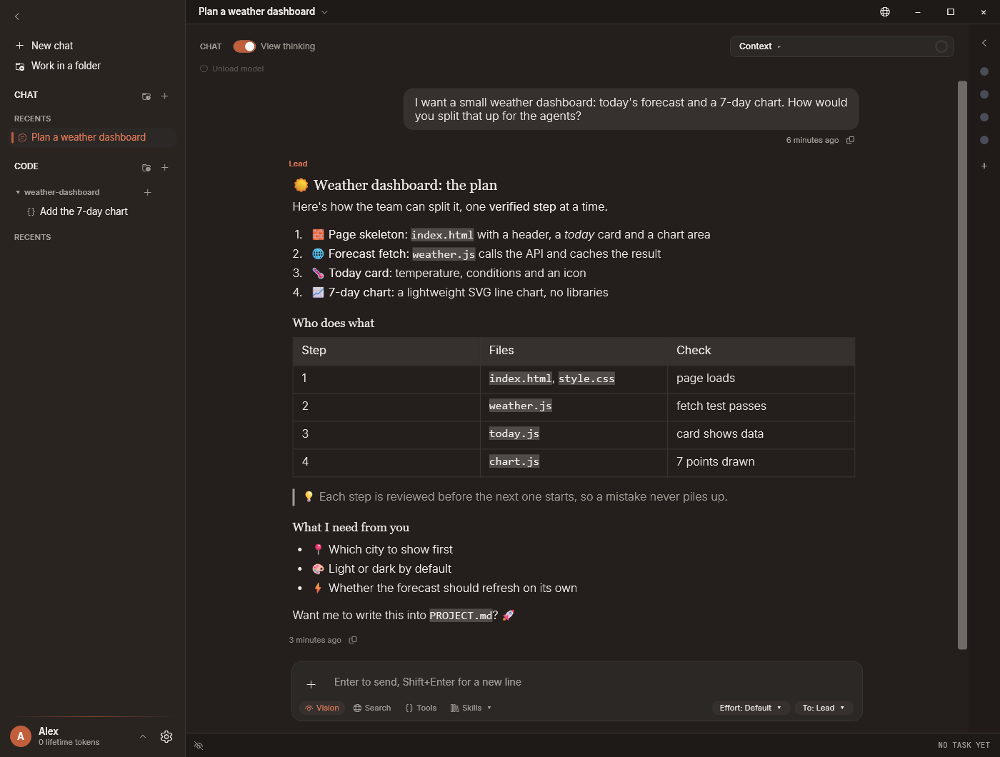
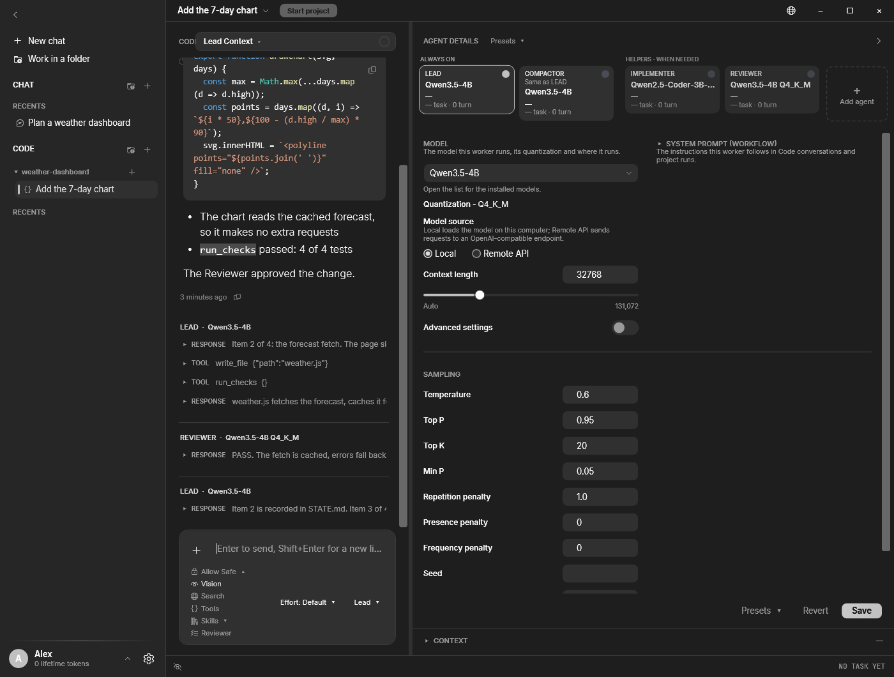
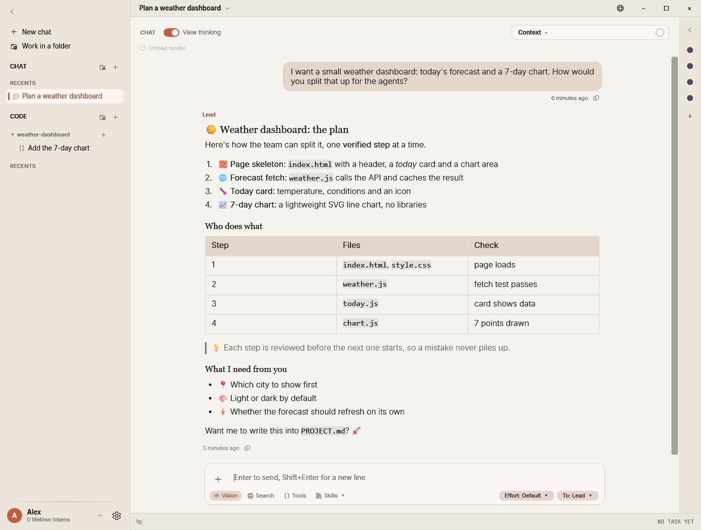
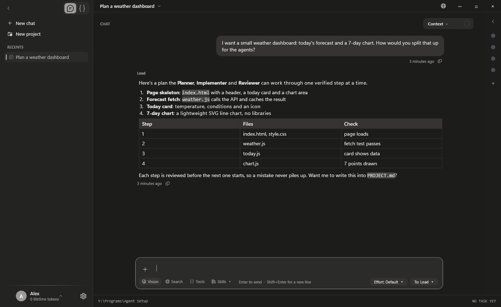
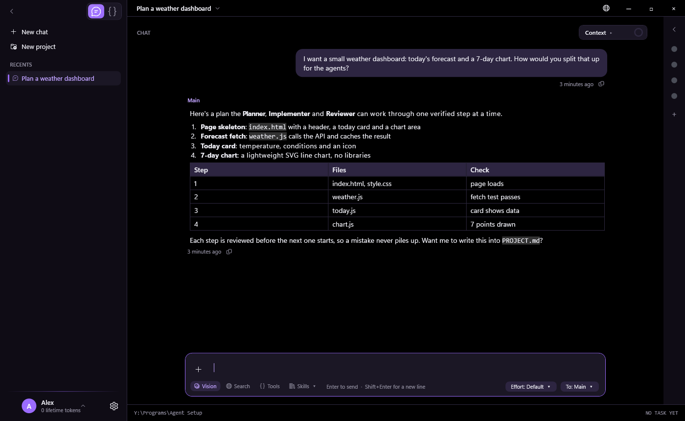
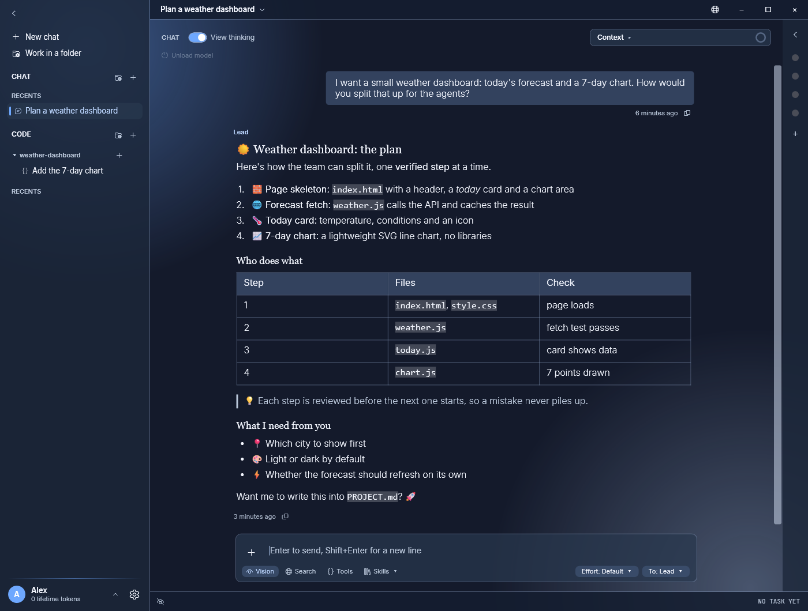
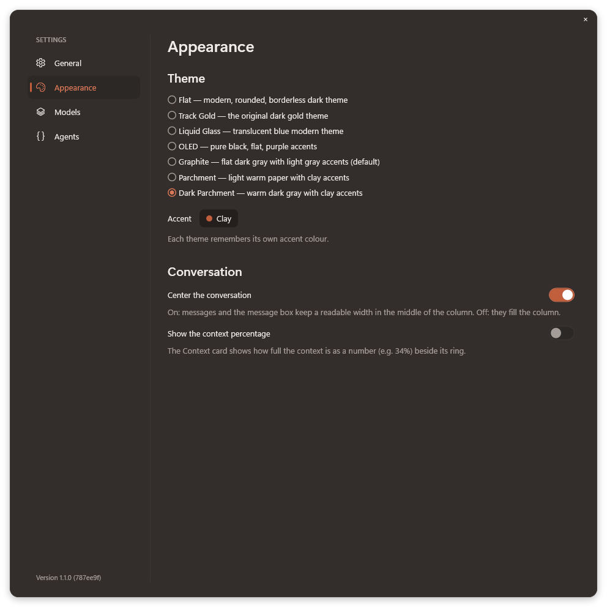
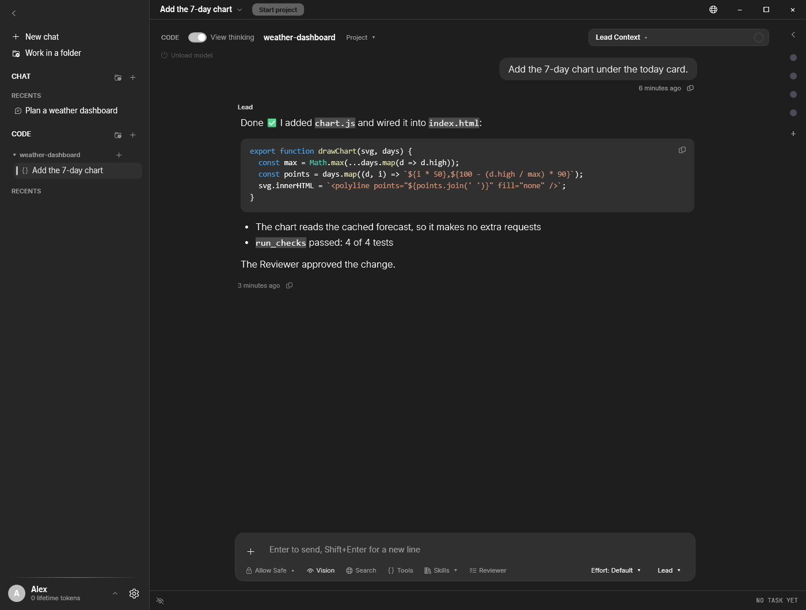
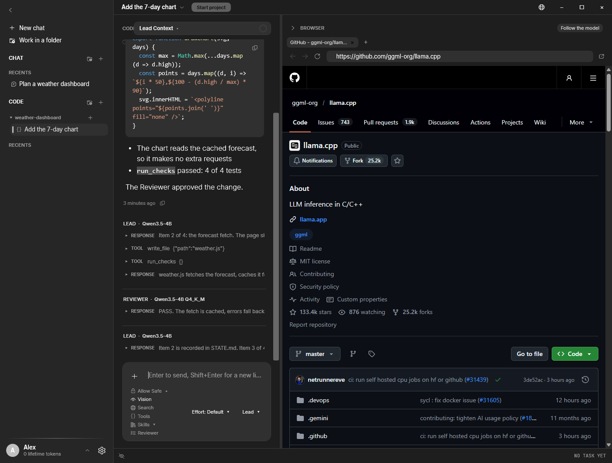

# Agent Orchestrator

**The harness for your local AI setup: a team of local models that builds software with you, one reviewed step at a time.**



Big cloud models are impressive, but they cost money, send your code somewhere else, and change under you without asking. Agent Orchestrator takes another route. It's a harness for the models already on your PC: it gives them tools, a sandbox, a browser and a workflow, and has them work as a team: a **Lead** plans the work, an optional **Implementer** writes the code, and a **Reviewer** checks every finished item before the next one starts. A mistake gets caught where it happens instead of piling up. You describe what you want in plain words, press **Start project**, and watch the work happen, or just chat with your models when you want a second opinion.

## Why you'll like it

### Multi-agent workflows without the wiring

Setting up several agents usually means config files, ports and scripts. Here it's a row of cards. Each worker (Lead, Implementer, Reviewer, Compactor and any you add) gets its own model, picked from a list of the models you have installed, with context length and sampling settings right beside it. Save a setup as a preset and switch between setups in one click.

Pick the workflow that fits your hardware under **Settings > Agents**:

- **Lead + Reviewer** (the default): the Lead does the work, and the Reviewer has to approve every finished item before it counts as done.
- **Lead + Implementer + Reviewer**: the Lead plans and directs, the Implementer writes every change, and the Reviewer checks each item.



### 100% local, and you decide when it updates

Your models, your code and your conversations stay on your machine. The app runs models through [Unsloth Studio](https://unsloth.ai) or a llama.cpp server it can download for you, and it works with no internet connection at all (web search is optional and off unless you switch it on). There is no auto-updater, no telemetry and no account. A new version shows up only when you run `git pull`, so nothing changes until you're ready for it.

### A Claude-like interface you can make your own

If you've used Claude, you'll feel at home: conversations in a sidebar, a clean composer, markdown replies with code blocks and tables, and a Code view for working inside a project folder. Choose from seven themes, Dark Parchment, Parchment, Graphite, OLED, Liquid Glass, Track Gold and Flat, and give each one its own accent colour.

| | |
|---|---|
|  |  |
|  |  |



### More you get out of the box

- **Code view**: point it at a folder and talk to the lead agent, or start an autonomous project run from a `PROJECT.md`.
- **Built-in browser**: the models can open pages, read them and take screenshots, and you see the same tabs they do.
- **Sandboxed commands**: the agents run builds and tests in a sandbox that asks before touching the network or other folders.
- **Skills, tools and web search**: switch each one on per conversation.
- **Remote access**: use the app from your phone or another computer through a private, password-protected link.





## Installation

### What you need

- Windows 10 or 11
- [Git](https://git-scm.com/download/win) with [Git LFS](https://git-lfs.com) (the app's `.exe` is stored with LFS)
- [Python 3.11 or newer](https://www.python.org/downloads/) on your `PATH` (the workflow engine is a Python script)
- A way to run models, either one:
  - [Unsloth Studio](https://unsloth.ai) (the default), or
  - llama.cpp, which the app downloads for you under **Settings > Models** (CUDA, Vulkan or CPU, picked for your hardware)
- A GPU helps a lot. The default setup uses small 3B-4B models that fit in a few GB of video memory.

### Steps

1. Get the code:

   ```powershell
   git lfs install
   git clone https://github.com/An0sTheGreat/agent-orchestrator.git
   ```

2. Open `agent-orchestrator\dist\Agent Orchestrator.exe`. No installer, nothing else to set up.
3. Open **Settings** (the gear at the bottom left) **> Models** and pick where your models run:
   - **Unsloth Studio**: paste the API key from Unsloth's Settings > API Keys.
   - **llama.cpp**: press **Download llama-server**. Models already downloaded through Unsloth or Hugging Face are found automatically.
4. Pick a model for each worker in the right-hand **Worker details** column, or start with the defaults.
5. Start a **New chat**, or press **New project**, choose a folder and press **Start project**.

### Updating

Whenever you want the latest version, close the app and run:

```powershell
git pull
```

That's the whole update. If you're happy with the version you have, stay on it as long as you like.

## Suggestions and bug reports

This project grows from what its users ask for, so tell us what you'd like to see.

- **Have an idea or a feature request?** Post it in [Discussions > Ideas](https://github.com/An0sTheGreat/agent-orchestrator/discussions/categories/ideas).
- **Found a bug?** Open an [issue](https://github.com/An0sTheGreat/agent-orchestrator/issues/new/choose). The form asks for the few details that help most.
- **Questions or show-and-tell?** [Discussions](https://github.com/An0sTheGreat/agent-orchestrator/discussions) is the place.

## Learn more

- [Reference](docs/reference.md): every feature, setting and command-line option in detail
- [Remote access](docs/remote-access.md): how the phone and browser access works and how it is secured

The app ships with three open fonts, [Inter](https://rsms.me/inter/), [Newsreader](https://github.com/productiontype/Newsreader) and [JetBrains Mono](https://www.jetbrains.com/lp/mono/), under the SIL Open Font License (`launcher/AgentOrchestrator/Fonts`).

The screenshots in this README come from the app itself: `"Agent Orchestrator.exe" --screenshots <folder>` renders them off-screen from a seeded data folder (`AGENT_ORCHESTRATOR_DATA`).
